# Architecture

How go-aip is layered, which imports are allowed and how that is enforced, where each kind of test lives, and how to add a storage backend.
The package list and the AIP coverage are in the [README](../README.md); the contributor rules are in `AGENTS.md`.

## Layers

| Layer                    | Packages                                                                                                                                           | Role                                                                                                                                                                    |
|--------------------------|----------------------------------------------------------------------------------------------------------------------------------------------------|-------------------------------------------------------------------------------------------------------------------------------------------------------------------------|
| Standard-method helpers  | `apierror`, `batch`, `requestid`, `resourcename`, `state`, `unreachable`, `pagination/page`, `pagination/pagetoken`, `metrics`                     | Leaves: no other go-aip package below them (except internal ones), so a service can use one without linking the DSL stack                                               |
| Protobuf message helpers | `fieldinfo`, `fieldbehavior`, `etag`, `fieldmask` (`update`, `extract`), `validateonly`                                                            | Checks and updates of protobuf messages driven by descriptors and annotations                                                                                           |
| Request DSLs (core)      | `fieldpolicy`, `decimal128`, `filter` (+ `parser`, `evaluator`, `functions`, `regexanchor`), `orderby`, `projection` (+ `protopath`), `softdelete` | The AST, the policies, the limits, the translator contracts (ports) and the errors of `filter`, `order_by` and read masks, the decimal128 range of decimals; no backend |
| Listing contract         | `listing`, `listing/evaluation`                                                                                                                    | The immutable list schema and profile, the `listing.Engine` contract and the portable proto3 evaluator profile                                                          |
| Error mapping            | `apierror/aipmap`                                                                                                                                  | Maps every go-aip and go-atlas-core sentinel to a code and reason; it imports most of the library by design                                                             |
| SQL dialect kit          | `backend/sqlbase`, `backend/sqlbase/sqltype`, `backend/sqlbase/sqlbasetest`                                                                        | Dialect-generic SQL: predicate builder, schema, decoder, order, projection and keyset list engine; the type checker; the scripted driver                                |
| Backends                 | `backend/postgres`, `mariadb`, `clickhouse`, `mongo`, `redis`, `meili`, `lua`, `memory`                                                            | One package per storage technology: translators, schema, evaluator profile and list engine of that technology                                                           |
| Test support             | `*test` packages, `internal/testhelpers`, `internal/proto`, modules `integration/crossbackend` and `integration/docker`                            | Conformance suites, expectation tables, fixtures, the cross-backend checks and the live suites; never imported by production code                                       |

The `internal/` packages of the root module (`behavior`, `literalvalue`, `lru`, `telemetry`, `typename`, `filter/internal/regexcache`,
`maskpath`, `maskwalk`, `maskmerge`) are shared building blocks of the layers above and import no exported go-aip
package except `metrics`. The MongoDB backend keeps BSON struct field lookup in `internal/bsonstruct` and uses go-mongox for BSON
codecs, bounded writes, raw validation, filter preparation, keyset pagination and index creation.

### Dependency graph

Production imports of every package of the root module and of the backend modules, with test-support and internal packages left out and
the graph transitively reduced (an edge implied by a longer path is dropped). It is generated from
`go list -f '{{.ImportPath}} {{join .Imports " "}}' ./...` run in every released module; regenerate it when a production import between two
packages changes.

```mermaid
flowchart TB
  subgraph helpers["Standard-method helpers"]
    apierror["apierror"]
    batch["batch"]
    requestid["requestid"]
    resourcename["resourcename"]
    state["state"]
    unreachable["unreachable"]
    pagination_page["pagination/page"]
    pagination_pagetoken["pagination/pagetoken"]
    metrics["metrics"]
  end
  subgraph proto["Protobuf message helpers"]
    fieldinfo["fieldinfo"]
    fieldbehavior["fieldbehavior"]
    etag["etag"]
    fieldmask["fieldmask"]
    fieldmask_update["fieldmask/update"]
    fieldmask_extract["fieldmask/extract"]
    validateonly["validateonly"]
  end
  subgraph dsl["Request DSLs"]
    fieldpolicy["fieldpolicy"]
    decimal128["decimal128"]
    filter["filter"]
    filter_parser["filter/parser"]
    filter_evaluator["filter/evaluator"]
    filter_functions["filter/functions"]
    filter_regexanchor["filter/regexanchor"]
    orderby["orderby"]
    projection["projection"]
    projection_protopath["projection/protopath"]
    softdelete["softdelete"]
  end
  subgraph listinggroup["Listing contract and error mapping"]
    listing["listing"]
    listing_evaluation["listing/evaluation"]
    apierror_aipmap["apierror/aipmap"]
  end
  subgraph sql["SQL dialect kit"]
    backend_sqlbase["backend/sqlbase"]
    backend_sqlbase_sqltype["backend/sqlbase/sqltype"]
  end
  subgraph backends["Backends"]
    backend_mongo["backend/mongo"]
    backend_postgres["backend/postgres"]
    backend_mariadb["backend/mariadb"]
    backend_clickhouse["backend/clickhouse"]
    backend_redis["backend/redis"]
    backend_meili["backend/meili"]
    backend_lua["backend/lua"]
    backend_memory["backend/memory"]
  end
  apierror_aipmap --> apierror
  apierror_aipmap --> batch
  apierror_aipmap --> fieldmask_extract
  apierror_aipmap --> fieldmask_update
  apierror_aipmap --> listing
  apierror_aipmap --> projection_protopath
  apierror_aipmap --> requestid
  apierror_aipmap --> resourcename
  apierror_aipmap --> softdelete
  apierror_aipmap --> state
  apierror_aipmap --> unreachable
  apierror_aipmap --> validateonly
  backend_clickhouse --> backend_sqlbase_sqltype
  backend_lua --> filter
  backend_mariadb --> backend_sqlbase_sqltype
  backend_meili --> filter
  backend_meili --> orderby
  backend_meili --> projection
  backend_memory --> fieldmask
  backend_memory --> listing_evaluation
  backend_mongo --> apierror
  backend_mongo --> filter_evaluator
  backend_mongo --> listing
  backend_postgres --> backend_sqlbase_sqltype
  backend_postgres --> filter_evaluator
  backend_redis --> filter
  backend_redis --> orderby
  backend_redis --> projection
  backend_sqlbase --> apierror
  backend_sqlbase --> listing
  backend_sqlbase_sqltype --> backend_sqlbase
  etag --> fieldbehavior
  fieldbehavior --> fieldinfo
  fieldmask_update --> etag
  fieldmask_update --> fieldmask
  filter --> decimal128
  filter --> fieldpolicy
  filter --> filter_regexanchor
  filter --> metrics
  filter_evaluator --> filter
  filter_functions --> filter
  filter_parser --> filter
  listing --> filter_parser
  listing --> orderby
  listing --> pagination_page
  listing --> pagination_pagetoken
  listing --> projection
  listing_evaluation --> filter_evaluator
  listing_evaluation --> listing
  orderby --> fieldpolicy
  orderby --> metrics
  projection --> fieldpolicy
  projection --> metrics
  projection_protopath --> projection
  softdelete --> filter
  validateonly --> fieldbehavior
```

No arrow leaves a core package for `backend/`, and no backend points at a sibling other than the SQL dialect kit. `listing` links the CEL parser
(`filter/parser`), so every list engine and `apierror/aipmap` link cel-go; the standard-method helpers and the protobuf message helpers do not.

## Core and backends

### Request DSLs and their ports

`filter`, `orderby` and `projection` each split configuration into a parser (syntax and resource limits), a policy (what a client may ask for,
in API names, built once per resource and shared) and translator options (how one backend renders a validated request); see
[Parser / policy / translator](../README.md#parser--policy--translator). The core packages define the ports a backend implements
(`filter.Translator[Out]`, the order and projection translator contexts, `listing.Engine`) and the sentinels every backend returns; they name
no backend and import no driver.

### The evaluator: reference semantics and its profile seam

[`filter/evaluator`](../filter/evaluator/README.md) is the reference semantics of the filter language. It supports every operator and operand
shape any translator supports and gives a null or absent value SQL three-valued (Kleene) logic, so its selection over a data set is the
selection the SQL translators produce. The conformance suite compares every translator with it.

A backend whose stored semantics differ supplies them through the evaluator's profile seam rather than through code in the core:

| Port                      | Implemented by                          | Purpose                                                                                                            |
|---------------------------|-----------------------------------------|--------------------------------------------------------------------------------------------------------------------|
| `evaluator.Profile`       | every profile                           | Validates the policy against the profile's contract                                                                |
| `evaluator.Compiler`      | `postgres.Schema`, `listing/evaluation` | Compiles a filter into a concurrency-safe `Program` with the profile's semantics                                   |
| `evaluator.Binder`        | `mongo.Schema`                          | Binds to the evaluator's policy and `ValueEncoding` once and returns the `Compiler` it evaluates every filter with |
| `evaluator.FieldAccessor` | optional on a compiler                  | Reads one field for `Evaluator.Lookup`                                                                             |

`evaluator.WithProfile(nil)` keeps the native semantics. The MongoDB matching rules (missing fields under negation, array traversal, omitted
empty values) live in `backend/mongo`, which compiles them over the exported evaluator primitives; the PostgreSQL profile lives in
`backend/postgres`; the portable proto3 listing semantics live in `listing/evaluation`.

### The listing contract and its engines

[`listing`](../listing/README.md) owns the request side of a List method: the immutable `Schema` (fields, sort patterns, profile), request
parsing and validation, the page size rules, the filter and order policies it derives, and the `Engine[T, S]` interface. It runs no query. An
engine binds those policies to its storage and executes them:

| Engine                          | Package                                                                           | Conformance                                                                                                               |
|---------------------------------|-----------------------------------------------------------------------------------|---------------------------------------------------------------------------------------------------------------------------|
| In memory                       | `backend/memory`                                                                  | `listingtest.Run` in its unit tests                                                                                       |
| PostgreSQL, MariaDB, ClickHouse | `backend/sqlbase` with the dialect of `backend/postgres`, `mariadb`, `clickhouse` | Statement shape against `sqlbasetest`; `listingtest.Run` against live servers in `integration/docker`                     |
| MongoDB                         | `backend/mongo`                                                                   | Planning in its unit tests; `listingtest.Run` and explain-plan index checks against a live server in `integration/docker` |

The MongoDB engine translates the request filter with the `backend/mongo` filter translator and reads keyset pages through the driver; its
value encoding (`mongo.ValueEncoding`) lets an in-memory evaluator or the memory engine read documents the way the driver stores them.

## Dependency rules

| # | Rule                                                                                                                                                                                                                             | Checked             |
|---|----------------------------------------------------------------------------------------------------------------------------------------------------------------------------------------------------------------------------------|---------------------|
| 1 | A core package (the root module) imports no `backend/` package                                                                                                                                                                   | non-test files      |
| 2 | A backend imports no other backend, except `backend/sqlbase` and its subpackages                                                                                                                                                 | non-test files      |
| 3 | A production package imports no test-support package (an element ending in `test`, or `internal/testhelpers`)                                                                                                                    | non-test files      |
| 4 | No root-module package imports a database driver or client (mongo-driver, pgx, pq, go-sql-driver, clickhouse-go, go-redis, rueidis, meilisearch-go)                                                                              | all, tests included |
| 5 | No package imports an `internal/` package of another module                                                                                                                                                                      | all, tests included |
| 6 | The tests of a core package import no backend                                                                                                                                                                                    | test files          |
| 7 | The tests of a backend import no other backend except `backend/sqlbase`; the tests of `backend/sqlbase` may import only the SQL dialects built on it                                                                             | test files          |
| 8 | The root module requires no other module of the repository; a backend module requires only the root, a SQL dialect also `backend/sqlbase` and `backend/sqlbase` the SQL dialects; no released module requires a test-only module | `go.mod`            |

`TestLayering` in [`arch_test.go`](../arch_test.go) enforces all eight. It runs `go list -json ./...` and `go mod edit -json` in every module
of the repository (`devtools` excepted), applies rules 1 to 7 to the `Imports`, `TestImports` and `XTestImports` of each package and rule 8 to
the `require` lines of each `go.mod`, and fails with one message per violation; `TestLayeringViolations` pins each rule on synthetic
listings. The test-only modules `integration/crossbackend` and `integration/docker` are exempt from rules 1 to 3, 6 and 7 and may require any
module of the repository, because all of them is test support, but not from rule 5. The check runs with `go test ./...` in the root module,
so `make test` and CI keep the graph above honest.

Rule 7 lets the tests of `backend/sqlbase` check the shared code through the PostgreSQL, MariaDB and ClickHouse dialects, so the
`backend/sqlbase` module requires the three dialect modules and each of them requires `backend/sqlbase`: a module cycle, which Go allows. The
cycle carries only test imports (the production packages of `backend/sqlbase` import no dialect, rule 2), and the four modules are released
together under one version.

## Tests

| Kind                 | Where                                                                                                                                                           | Runs                                                                                            |
|----------------------|-----------------------------------------------------------------------------------------------------------------------------------------------------------------|-------------------------------------------------------------------------------------------------|
| Unit tests           | Next to the code, black-box `_test` packages                                                                                                                    | `make test`                                                                                     |
| Conformance suites   | `filter/filtertest`, `orderby/orderbytest`, `projection/projectiontest`, `listing/listingtest`, `requestid/requestidtest`, `pagination/pagetoken/pagetokentest` | Called by the unit tests of every backend, engine, store or signer that implements the contract |
| Expectation tables   | `backend/<name>/<name>test` (PostgreSQL, MariaDB, ClickHouse, MongoDB)                                                                                          | Shared by the unit tests and the live suites so both assert the same query                      |
| Cross-backend checks | Module [`integration/crossbackend`](../integration/crossbackend/README.md)                                                                                      | One policy through several translators, the backend sentinel table, parity across backends      |
| Live suites          | Module [`integration/docker`](../integration/docker/README.md), build tag `integration_docker`                                                                  | `make test-integration-docker` (needs Docker): live PostgreSQL, MariaDB, ClickHouse and MongoDB |
| Layering             | [`arch_test.go`](../arch_test.go)                                                                                                                               | `make test`                                                                                     |

Behavior shared by every backend is asserted once in a conformance suite and run by each backend. `filtertest.RunConformance` runs the
evaluator and every filter translator (PostgreSQL, MariaDB, ClickHouse, MongoDB, RediSearch, Meilisearch, Lua) over the same cases;
`orderbytest.RunConformance` and `projectiontest.RunConformance` do the same for order and projection translators; `listingtest.Run` and
`RunWithoutArrays` run list engines. A check that needs several concrete backends in one test goes to the test-only module
`integration/crossbackend`, never into the tests of a core package (rule 6) or of a backend (rule 7).

The live suites start each server with testcontainers-go and compare the rows it selects with the evaluator's selection over
`filtertest.ConformanceRecords` (for MongoDB, the evaluator with the MongoDB profile), so a translator that renders a valid query with different
semantics fails there. Each test skips when Docker does not answer.

## Modules

| Module                     | Contents                                                                                                                                          | Released                    |
|----------------------------|---------------------------------------------------------------------------------------------------------------------------------------------------|-----------------------------|
| `.`                        | Every core package: the request DSLs, the listing contract, the standard-method and protobuf helpers                                              | yes                         |
| `backend/sqlbase`          | The SQL dialect kit (`sqlbase`, `sqltype`, `sqlbasetest`)                                                                                         | with the root, same version |
| `backend/postgres`         | PostgreSQL translators, schema, evaluator profile and list engine; `postgrestest`                                                                 | with the root, same version |
| `backend/mariadb`          | MariaDB translators, schema and list engine; `mariadbtest`                                                                                        | with the root, same version |
| `backend/clickhouse`       | ClickHouse translators, schema and list engine; `clickhousetest`                                                                                  | with the root, same version |
| `backend/mongo`            | MongoDB translators, schema, evaluator profile, list engine, value encoding and codecs; `mongotest`; keeps mongo-driver out of every other module | with the root, same version |
| `backend/redis`            | RediSearch translators and index schema                                                                                                           | with the root, same version |
| `backend/meili`            | Meilisearch translators                                                                                                                           | with the root, same version |
| `backend/lua`              | Lua filter translator; keeps gopher-lua (its tests) out of every other module                                                                     | with the root, same version |
| `backend/memory`           | In-memory order comparator, projection and list engine                                                                                            | with the root, same version |
| `integration/crossbackend` | Checks that need several backends in one test (rule 6)                                                                                            | never                       |
| `integration/docker`       | Live suites; keeps testcontainers-go and the SQL drivers out of every released module                                                             | never                       |

The root module requires no backend module and no database driver (rules 4 and 8), so an application links only the backends it imports. A
backend module requires the root (and `backend/sqlbase` for a SQL dialect) through a placeholder version and a `replace` directive to the
checkout; `make release` rewrites every go-aip requirement to the released version. A backend module imports only exported root packages
(rule 5), because a consumer may combine it with a newer root release under minimal version selection; `make nested-build-check` also vets
every released module against the root without a `replace`.

## Adding a backend

### In this repository

1. Create `backend/<name>` with the kind-prefixed API: `NewFilterTranslator`/`FilterOption`/`WithFilter…`, `NewOrderTranslator`,
   `NewProjectionTranslator`, `NewSchema`, `NewListEngine` and their options, each generated with optgen. Every translator constructor takes
   the shared policy first and fails with `ErrPolicyRequired` for nil.
2. Make it a module: `backend/<name>/go.mod` requiring the root (and `backend/sqlbase` for a SQL database) with a placeholder version and a
   `replace` to the checkout, like the other backends. Import only exported core packages, plus `backend/sqlbase` and its subpackages for a
   SQL database (rules 2 and 5).
3. Run the conformance suite of every kind it implements: `filtertest.RunConformance(t, filtertest.Backend{…})`,
   `orderbytest.RunConformance`, `projectiontest.RunConformance`, `listingtest.Run`. Refuse what the backend cannot express with the shared
   sentinels (`filter.ErrUnsupportedOperation`, …) instead of changing the meaning, and document every divergence from the evaluator in the
   backend README.
4. If the stored semantics differ from the evaluator's, add an evaluator profile in the backend (`evaluator.Compiler`, or `evaluator.Binder`
   when it reads through a `ValueEncoding`), never a branch in the core.
5. Add `doc.go`, `README.md` (what the backend can express, with its conformance gaps), rows in the two backend tables and the module table of
   the root README, and through the template parameters a commit scope and the module in `MODULES`, `NESTED_MODULES` and the Dependabot
   directories. Add the module to the `go.mod` of `integration/crossbackend` (a `require` and a `replace`): a new exported `Err*` sentinel
   needs a row in its backend sentinel table and a rule in `apierror/aipmap` (`backend/mongo`, which that module does not require, keeps its
   rows in `errors_test.go`).
6. For a SQL server, add a live package to `integration/docker` and a driver-free `backend/<name>/<name>test` package for the expectation
   tables the unit and live suites share.

### Outside this repository (a SQL dialect on the kit)

Everything a SQL dialect needs is exported, so a module outside go-aip can build one exactly like the PostgreSQL, MariaDB and ClickHouse
packages ([dialect kit](../backend/sqlbase/README.md#dialect-kit)):

| Step                  | API                                                                                                                                                                                                                                                       |
|-----------------------|-----------------------------------------------------------------------------------------------------------------------------------------------------------------------------------------------------------------------------------------------------------|
| Identifiers and binds | `sqlbase.Style{Quote, Numbered}` (`QuoteIdent`, `Table`, `IndexName`, `Bind`) and `sqlbase.Identifiers` for order and projection columns                                                                                                                  |
| Filter                | Implement `sqlbase.FilterDialect` and the optional extensions it supports (`ArrayDialect`, `NullSafeDialect`, `DecimalDialect`, `TimestampDialect`, `SubstringDialect`, `QualifiedNamesDialect`); `sqlbase.NewFilterTranslator(policy, dialect, opts...)` |
| Schema-aware filter   | `sqlbase.Schema` plus a `sqltype.Dialect` given to `sqltype.Checker`, then render the typed tree it returns                                                                                                                                               |
| Order and projection  | `sqlbase.OrderDialect` and `sqlbase.ProjectionDialect` values; `sqlbase.NewOrderTranslator`, `sqlbase.NewProjectionTranslator`                                                                                                                            |
| List engine           | Implement `sqlbase.ListDialect` (with `ListFilterDialect`, `ListSchemaDialect`, `ListIndexDialect`, `ListSortKeyDialect` as needed); `sqlbase.NewListEngine`                                                                                              |
| Tests                 | `sqlbasetest.NewFakeDB` for statement shape and argument order, then `filtertest`, `orderbytest`, `projectiontest` and `listingtest` against a live server                                                                                                |

A non-SQL backend (a search engine or a key-value store) needs only the public `filter`, `orderby`, `projection` and `metrics` packages and the
three translator conformance suites, as `backend/redis`, `backend/meili` and `backend/lua` show.
